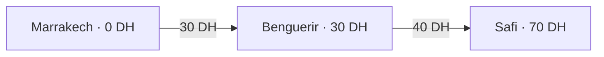
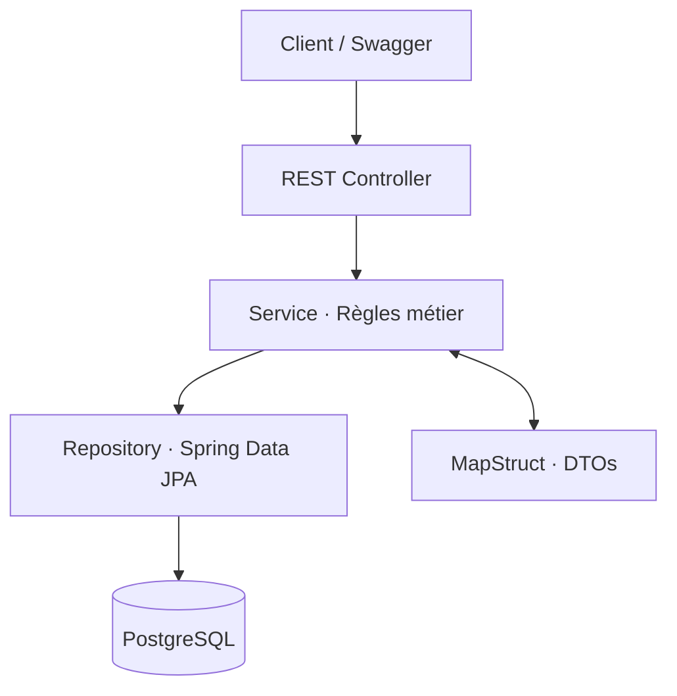
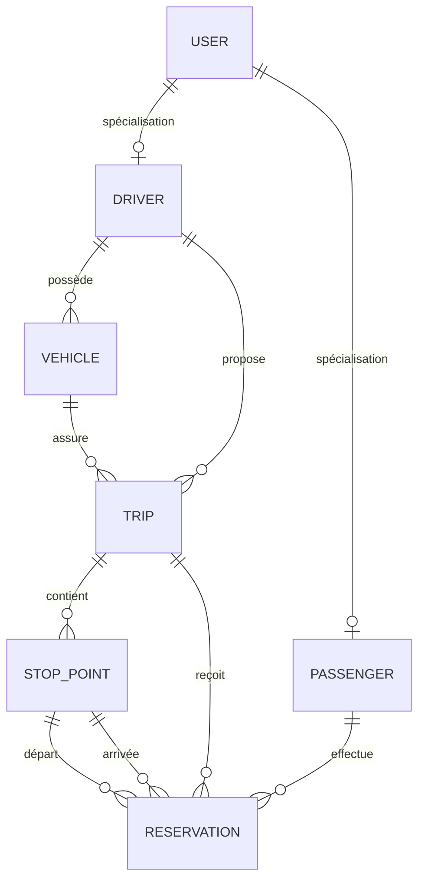

<div align="center">

# 🚗 GoTogether

### Plateforme de covoiturage multi-étapes

**Voyagez ensemble. Partagez les frais. Optimisez chaque trajet.**


**YouCode – UM6P | Campus Youssoufia**  
Projet de soutenance croisée · Formation Full Stack Java  
Novembre 2026 · Planning initial : 16–20 novembre 2026

</div>

---

## 📖 Présentation

GoTogether est une API REST de covoiturage permettant aux conducteurs de publier des trajets avec plusieurs points d'arrêt et aux passagers de réserver uniquement le segment correspondant à leur besoin.

Contrairement à un système de réservation classique, une place peut être réutilisée par différents passagers sur des segments distincts d'un même trajet. Le système calcule les tarifs et vérifie la disponibilité des places en fonction du parcours réservé.

## 🎯 Objectifs

- Faciliter le partage des trajets et des frais de déplacement.
- Permettre la réservation entre deux arrêts d'un même itinéraire.
- Gérer la disponibilité des places par segment.
- Centraliser les règles métier dans une architecture backend maintenable.
- Exposer une API REST documentée et testable.

## ✨ Fonctionnalités

| Module | Fonctionnalités |
|---|---|
| Utilisateurs | Distinction entre conducteur et passager |
| Véhicules | Association d'un véhicule à son conducteur et gestion de sa capacité |
| Trajets | Création, consultation, modification et suppression |
| Points d'arrêt | Création avec le trajet, ordre automatique, horaires et tarifs cumulés |
| Recherche | Recherche multicritère par villes, date, nombre de places proposées et prix maximum |
| Réservations | Réservation par segment, calcul du montant et contrôle de disponibilité |
| Annulation | Changement de statut et libération des places sur les segments concernés |

## 🧠 Règles métier

### Publication d'un trajet

- Le véhicule doit exister et le conducteur est récupéré depuis celui-ci.
- Le nombre de places proposées doit être positif et respecter la capacité du véhicule.
- Un trajet doit comporter au minimum deux points d'arrêt.
- L'ordre des arrêts est généré automatiquement par le backend.
- Les horaires de passage doivent être strictement chronologiques et ne peuvent pas précéder le départ du trajet.
- Le premier arrêt possède un tarif de zéro ; les tarifs cumulés ne doivent pas diminuer.
- La règle de publication retenue vise à empêcher plusieurs trajets non terminés pour un même véhicule.

### Réservation par segment

- Le passager et le trajet doivent exister.
- Seuls les utilisateurs de type Passenger peuvent réserver.
- Le trajet doit être publié (`PUBLIE`).
- Les deux points d'arrêt doivent appartenir au trajet sélectionné.
- Le départ doit précéder l'arrivée dans l'ordre des arrêts.
- Chaque segment demandé doit disposer de suffisamment de places.
- Le montant total, la date et le statut sont définis par le backend.
- La réservation est initialisée avec le statut `CONFIRMEE`.

### Annulation

- Seule une réservation confirmée peut être annulée.
- Une réservation déjà annulée ne peut pas être annulée une seconde fois.
- Le passager peut annuler jusqu'à 24 heures avant son départ, selon l'heure de passage à son arrêt.
- La réservation passe au statut `ANNULEE` sans être supprimée.
- Les réservations annulées ne sont plus comptabilisées dans l'occupation des segments.

## 🚦 Comment fonctionne la réservation multi-étapes ?



Exemple illustratif avec un véhicule proposant quatre places :

| Segment | Places proposées | Places réservées | Places restantes |
|---|---:|---:|---:|
| Marrakech → Benguerir | 4 | 3 | 1 |
| Benguerir → Safi | 4 | 1 | 3 |

Un passager souhaitant effectuer l'ensemble du trajet ne peut réserver qu'une place. Un passager montant à Benguerir peut en réserver trois.

La capacité initiale du trajet reste inchangée en base de données. La disponibilité est calculée à partir des réservations qui occupent chaque segment.

### Calcul du prix

```text
Prix par place = Tarif cumulé à l'arrivée − Tarif cumulé au départ
Prix total     = Prix par place × Nombre de places
```

Exemple : deux places de Benguerir à Safi coûtent `(70 − 30) × 2 = 80 MAD`.

## 🛠️ Stack technique

| Technologie | Utilisation |
|---|---|
| Java | Langage backend |
| Spring Boot / Spring MVC | API REST et injection de dépendances |
| Spring Data JPA / Hibernate | Persistance et requêtes JPQL |
| PostgreSQL | Base de données relationnelle |
| MapStruct | Conversion entre entités et DTOs |
| Jakarta Validation | Validation des requêtes |
| Lombok | Réduction du code répétitif |
| Maven | Gestion des dépendances et compilation |
| Swagger / OpenAPI | Documentation et test des endpoints |
| Git / Jira | Versionnement et suivi des tâches |

## 🏗️ Architecture



```text
src/main/java/org/example/gotogether/
├── controller/
├── dto/
│   ├── request/
│   └── response/
├── entity/
├── enums/
├── exception/
├── mapper/
├── repository/
└── service/
    ├── TripService/
    └── ReservationService/
```

## 🗃️ Modèle de données simplifié



Diagramme conceptuel simplifié ; il ne représente pas la stratégie physique d'héritage JPA.

## 📡 API REST

### Trajets

| Méthode | Endpoint | Description |
|---|---|---|
| POST | `/api/trips` | Publier un trajet avec ses arrêts |
| GET | `/api/trips` | Lister les trajets |
| GET | `/api/trips/{id}` | Consulter un trajet |
| PUT | `/api/trips/{id}` | Modifier un trajet |
| DELETE | `/api/trips/{id}` | Supprimer un trajet |
| GET | `/api/trips/search` | Rechercher des trajets |

### Réservations

| Méthode | Endpoint | Description |
|---|---|---|
| POST | `/api/reservations` | Créer une réservation |
| GET | `/api/reservations/passenger/{passengerId}` | Lister les réservations d'un passager |
| PATCH | `/api/reservations/{id}/cancel` | Annuler une réservation |

Les routes ci-dessus correspondent aux contrôleurs élaborés pour le projet.

### Exemple : création d'un trajet

```json
{
  "departureDate": "2026-12-15T08:00:00",
  "proposedSeats": 3,
  "vehicleId": 1,
  "pointsRequests": [
    {"city": "Marrakech", "passageTime": "2026-12-15T08:00:00", "priceFromDeparture": 0},
    {"city": "Benguerir", "passageTime": "2026-12-15T09:00:00", "priceFromDeparture": 30},
    {"city": "Safi", "passageTime": "2026-12-15T11:30:00", "priceFromDeparture": 70}
  ]
}
```

Les identifiants et dates sont illustratifs et doivent être adaptés aux données disponibles.

### Exemple : recherche multicritère

```http
GET /api/trips/search?departureCity=Marrakech&arrivalCity=Safi&departureDate=2026-12-15&requiredSeats=2&maxPrice=100
```

Les villes sont obligatoires. La date, le prix maximum et le nombre de places sont facultatifs. La date constitue actuellement une borne inférieure de recherche. Le filtre de places de la recherche porte sur la capacité proposée ; le contrôle par segment intervient lors de la réservation.

### Exemple : création d'une réservation

```json
{
  "numberOfSeats": 2,
  "passengerId": 3,
  "tripId": 9,
  "departurePointId": 15,
  "arrivalPointId": 16
}
```

## 🚀 Installation et lancement

### Prérequis

- JDK compatible avec le `pom.xml` du projet
- PostgreSQL
- Git
- Maven ou Maven Wrapper

### Configuration locale

Créer une base PostgreSQL (par exemple `gotogether`) et adapter `src/main/resources/application.properties` :

```properties
spring.datasource.url=jdbc:postgresql://localhost:5432/gotogether
spring.datasource.username=${DB_USERNAME}
spring.datasource.password=${DB_PASSWORD}
```

Définir les variables d'environnement correspondantes avant le lancement. Ne jamais versionner les identifiants réels.

Depuis la racine du dépôt :

```bash
./mvnw clean compile
./mvnw spring-boot:run
```

L'API est accessible sur `http://localhost:8080` si le port par défaut est conservé.

Documentation Swagger, si Springdoc est activé :

- `http://localhost:8080/swagger-ui/index.html`
- `http://localhost:8080/v3/api-docs`

## 🧪 Vérifications et perspectives

Scénarios métier à couvrir : réservation sur un segment complet, saturation d'un segment intermédiaire, réutilisation des places après un arrêt, ordre invalide des points, prix incorrect et annulation à moins de 24 heures du départ.

Améliorations à prévoir :

- Protection contre les réservations concurrentes par verrouillage transactionnel.
- Contrôle des droits d'accès et de propriété des véhicules et réservations.
- Disponibilité réelle par segment dans les résultats de recherche.
- Gestion sécurisée des modifications de trajets déjà réservés.
- Tests unitaires et d'intégration des règles métier.

## 📅 Contexte pédagogique

| Information | Détail |
|---|---|
| Établissement | YouCode – Université Mohammed VI Polytechnique (UM6P) |
| Campus | Youssoufia |
| Formation | Développement Web Full Stack – Java |
| Projet | GoTogether – Soutenance croisée |
| Période initiale | 16 au 20 novembre 2026 |
| Organisation | Suivi des tâches avec Jira |

---

<div align="center">

**GoTogether** · Chaque étape compte.

Projet pédagogique réalisé dans le cadre de la formation YouCode – UM6P, promotion 2026–2027.

</div>